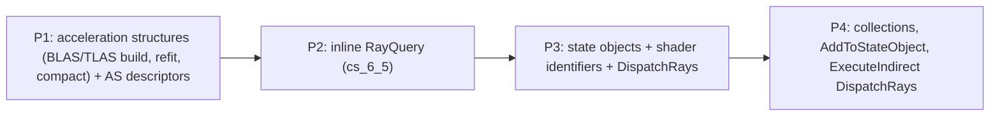

# DXR on Metal 4: design memo (M4)

Status: draft for advisor review, 2026-10-05. Owner: shaders engineer. Code will go in
`crates/aw2-d3d12/src/rt/**`, with hookups applied by the D3D12 engineer. Everything is behind
`AW2_RAYTRACING=1`; without it, `RaytracingTier` stays `NOT_SUPPORTED` and nothing changes.

Evidence markers:
- **[V]**: verified (header, test or measurement).
- **[A]**: assumed; must be proven by the phase's first test before anything is built on it.

## 1. What the game needs [V]

These numbers come from `aw2-shaders prewarm --game` over the 153 bundles.

| Profile | Programs | Converts today |
|---|---|---|
| `lib_6_5` raygen / miss / closesthit / anyhit | 288 / 88 / 88 / 88 | all |
| `lib_6_9` raygen (`rt_pathtracing`) | 642 | **0** (`UnsupportedInstruction`) |
| `cs_6_5` with `Raytracing_Tier_1_1` (inline `RayQuery`) | about 453 | all |
| `ms_6_5` (mesh, no AS) | 48 | all |

- **Both DXR models are present.** There are DXR 1.0 pipelines (`rt_*.binrfx` libraries plus
  `rt_shadertable`) and DXR 1.1 inline ray queries in compute shaders (`rt_*_compute`,
  ReSTIR, sun shadow).
- **The `lib_6_9` raygens are not needed.** They are the path tracer's SM 6.9 variants
  (shader execution reordering), and MSC can't convert them. `caps.rs` caps `HighestShaderModel`
  at 6.6, so the game should take the 6.5 path. Keep that cap.
- GPU descriptor handles are already raw Metal addresses (`metal/descriptor.rs`). Handles that
  local root arguments store in shader records therefore need no translation [V].

## 2. Phases



- P1 and P2 make the `*_compute` RT passes work. They are self-contained and testable with our
  own HLSL.
- P3 is the DXR 1.0 pipeline path.
- `RaytracingTier` reporting: 1.1 once P2 passes. The game may need P3 as well when it sees
  1.1; to be verified by tracing which passes it picks.

## 3. Acceleration structures (P1)

### 3.1 Key idea: a header at the D3D virtual address

In D3D12, an acceleration structure (AS) is an opaque byte range in a buffer, addressed by
GPU VA, and the app never reads it. MSC-converted shaders reach an AS through a 64-byte
`IRRaytracingAccelerationStructureGPUHeader` (`ir_raytracing.h`) [V]:

- `accelerationStructureID`: the Metal resource ID;
- `addressOfInstanceContributions`: a pointer to `u32[instanceCount]`;
- padding.

They find it through either of two paths:

- an SRV descriptor: `IRDescriptorTableSetAccelerationStructure(entry, va)`, which stores
  `gpuVA = va`;
- a root SRV, which stores the VA directly.

**So we write the header into the app's buffer at the destination VA itself.** The real
`MTLAccelerationStructure` lives in a separate Metal allocation. This gives us:

- **No VA translation anywhere.**
  - SRV creation of `RAYTRACING_ACCELERATION_STRUCTURE` stores `Location` as `gpuVA` (one
    line in views.rs).
  - Root SRVs pass through untouched.
  - Shader records and GPU-written descriptors just work.
- **Instance descriptors can be converted on the GPU** (section 3.3).
- **Simple size reporting.** `ResultDataMaxSizeInBytes` = 64 + 4 × instance count (TLAS), or
  64 (BLAS), rounded up to 256. The app sizes its buffers from what we report; Metal's real
  sizes stay private.

A device-wide map tracks the Metal objects: `BTreeMap<dest_va, AsEntry { mtl:
Retained<MTLAccelerationStructure>, size, kind, instance_count }>`.

- Lookups by VA happen on build, refit, copy and postbuild.
- Entries are dropped when their buffer resource is released, or when another build targets
  an overlapping range. The release is deferred through the queue's `defer_release`.
- Every live AS is in the device residency set. Metal 4 has no implicit residency, and a TLAS
  needs its BLASes resident.

### 3.2 Builds

D3D12 call → Metal 4:

- `GetRaytracingAccelerationStructurePrebuildInfo(inputs)`:
  - Build the matching `MTL4*AccelerationStructureDescriptor`. Only counts and formats
    matter; buffer ranges stay zero.
  - Call `device.accelerationStructureSizesWithDescriptor`.
  - Report `ResultDataMaxSizeInBytes` as in 3.1.
  - Report `ScratchDataSizeInBytes` = max(build, refit) scratch, and
    `UpdateScratchDataSizeInBytes` = refit scratch.
- `BuildRaytracingAccelerationStructure(desc, postbuild...)`, encoded on the list's compute
  encoder:
  - BLAS, triangles: `MTL4AccelerationStructureTriangleGeometryDescriptor` with the
    vertex, index and `Transform3x4` buffers taken straight from the VAs as `MTL4BufferRange`.
    - Mapping: vertex stride/format → `MTLAttributeFormat` (table in format_ext);
      `IndexFormat` → `MTLIndexType`.
    - A D3D 3×4 row-major transform → `transformationMatrixLayout = RowMajor`.
    - Geometry flags: `OPAQUE` → `opaque`; `NO_DUPLICATE_ANYHIT_INVOCATION` →
      `allowDuplicateIntersectionFunctionInvocation = false`.
  - BLAS, AABBs: `MTL4AccelerationStructureBoundingBoxGeometryDescriptor` (stride 32,
    6 floats per box, as in D3D).
  - TLAS: `MTL4InstanceAccelerationStructureDescriptor` with type `Indirect` and
    `instanceDescriptorBuffer` = our converted copy (section 3.3).
  - Build flags:
    - `PREFER_FAST_TRACE` → default usage;
    - `PREFER_FAST_BUILD` → `MTLAccelerationStructureUsage::PreferFastBuild`;
    - `ALLOW_UPDATE` → `Refit`;
    - `MINIMIZE_MEMORY` → ignored.
  - Destination:
    - Get or create the `MTLAccelerationStructure` from the map, reallocating when Metal's
      size grows.
    - Build with scratch = the app's scratch VA (we report Metal's scratch size, so the range
      is big enough).
    - Then a tiny compute pass, or a blit from an upload copy, writes the 64-byte header at
      `dest_va`.
  - `PERFORM_UPDATE` → `refitAccelerationStructure(descriptor, source, destination,
    scratch)`, where source and destination are looked up by VA (in place if they are equal).
- `EmitRaytracingAccelerationStructurePostbuildInfo` / the postbuild array of the build:
  - `COMPACTED_SIZE` → write 64 + 4 × instances. Metal's
    `writeCompactedAccelerationStructureSize` feeds our private reallocation, not the app.
  - `CURRENT_SIZE` → the same value.
  - `SERIALIZATION`, `TOOLS_VISUALIZATION` → `E_NOTIMPL`. The game shouldn't use them.
- `CopyRaytracingAccelerationStructure(dst, src, mode)`:
  - `CLONE` → copy into a new Metal AS of the same size;
  - `COMPACT` → `copyAndCompactAccelerationStructure` into a new AS whose size comes from a
    CPU readback of the compacted size (one frame late), or `copy` until it's known;
  - in both cases, then write the header at `dst`.

The command-list encoding order matters: build → header write → later uses, all on one
timeline. Barriers: a D3D UAV barrier on an AS buffer → a Metal 4 intra-pass barrier between
the AS-build and dispatch stages.

### 3.3 Converting instance descriptors (on the GPU)

D3D `D3D12_RAYTRACING_INSTANCE_DESC` is 64 bytes and the app writes it, possibly from a compute
shader. Metal needs `MTLIndirectAccelerationStructureInstanceDescriptor` (72 bytes). A utility
compute kernel (MSL, alongside `metal::clear`) runs before each TLAS build. For each instance i:

```text
src  = d3d_desc[i]
hdr  = (device Header*) src.AccelerationStructure          // BLAS VA → header we wrote [V: MSL allows ulong → device pointer cast]
dst[i].transformationMatrix = src.Transform (row-major; with layout RowMajor, copy as is)
dst[i].userID   = src.InstanceID (24 bits)
dst[i].mask     = src.InstanceMask
dst[i].options  = map(src.Flags): CULL_DISABLE → DisableTriangleCulling,
                  FRONT_CCW → TriangleFrontFacingWindingCounterClockwise,
                  FORCE_OPAQUE → Opaque, FORCE_NON_OPAQUE → NonOpaque
dst[i].intersectionFunctionTableOffset = 0      // the IFT holds only the 2 MSC wrappers (section 5)
dst[i].accelerationStructureID = hdr->accelerationStructureID   (0 for a null BLAS → instance skipped)
contributions[i] = src.InstanceContributionToHitGroupIndex     // in the TLAS's own buffer, after the header
```

- The converted array lives in a per-TLAS private buffer that we keep alive with the AS.
- The instance count is CPU-known (`NumDescs`), so we can use
  `MTL4InstanceAccelerationStructureDescriptor`. The indirect-count variant is not needed.
- `DescsLayout = ARRAY_OF_POINTERS` adds one more indirection in the kernel.

## 4. Inline ray queries (P2)

There is nothing to do in the converter: MSC already converts these 453 compute shaders [V].
Runtime requirements:

1. AS SRVs and root SRVs hold header VAs (P1).
2. Every AS a TLAS references is resident. They're in the device residency set.
3. Feature reporting: `RaytracingTier` = 1.1 when `AW2_RAYTRACING=1` and
   `device.supportsRaytracing`.

**Test:** our own `cs_6_5` HLSL builds a 2-triangle BLAS and a 2-instance TLAS, casts rays with
a RayQuery against `t0` (a descriptor table) and `t1` (a root SRV), and writes
hit/miss/instanceID/primitiveIndex/barycentrics to a UAV. We compare with a CPU reference.
A second dispatch covers a refit after moving a vertex, and a compaction.

## 5. State objects and DispatchRays (P3)

MSC's model [V headers; A where noted]:

- **Raygen** is compiled in **visible-function mode**
  (`IRRayGenerationCompilationVisibleFunction`). The synthesized
  `RaygenIndirection` kernel (`IRMetalLibSynthesizeIndirectRayDispatchFunction`) reads
  `IRDispatchRaysArgument` at buffer 3. It looks up the raygen record's shader identifier and
  calls that visible function. This gives full D3D SBT semantics: the app may pick any raygen
  record per dispatch.
- **Miss, closest hit, callable** are visible functions.
- **Hit groups with an any-hit and/or intersection shader** are fused by
  `IRCompilerAllocCombineCompileAndLink` (hit-group type triangles or procedural). The fused
  function is also a visible function.
- **The intersection function table holds just the two MSC wrappers**
  `irconverter.wrapper.intersection.function.{triangle,procedural}`
  (`IRMetalLibSynthesizeIndirectIntersectionFunction`). They call the fused visible function
  through the hit record's `intersectionShaderHandle`. Geometry type picks the wrapper:
  triangle geometry → IFT[0], AABB geometry → IFT[1], set via the geometry descriptor's
  `intersectionFunctionTableOffset` at BLAS build.
- **Shader identifier (32 bytes = `IRShaderIdentifier`)**: `{intersectionShaderHandle,
  shaderHandle, localRootSignatureSamplersBuffer, pad}`. The handles are indices into the state
  object's `MTLVisibleFunctionTable`. `GetShaderIdentifier(name)` returns these bytes; the app
  copies them into its tables (CPU or GPU, as `rt_shadertable` does). The local root arguments
  that follow are read by the converted shaders in D3D layout. [A: MSC's local layout =
  D3D's: constants 4 B, descriptors and tables 8 B, 8-aligned. Test it.]
- **Static samplers in a local root signature**: one sampler table per local RS, referenced
  by `localRootSignatureSamplersBuffer`.

`CreateStateObject` parsing (`D3D12_STATE_OBJECT_DESC`) handles these subobjects:

- `DXIL_LIBRARY` (with an export list or rename);
- `HIT_GROUP`;
- `RAYTRACING_SHADER_CONFIG` → `max_attribute_size`;
- `RAYTRACING_PIPELINE_CONFIG[1]` → `max_recursive_depth`, flags;
- `GLOBAL_` / `LOCAL_ROOT_SIGNATURE`;
- `SUBOBJECT_TO_EXPORTS_ASSOCIATION` (explicit and default association rules);
- `EXISTING_COLLECTION`;
- `STATE_OBJECT_CONFIG`;
- `NODE_MASK`.

Compilation steps:

1. Resolve exports, hit groups and associations, then collect every shader with its local RS.
2. Gather intrinsic masks: `IRObjectGatherRaytracingIntrinsics` per export, ORed per stage
   class into one `RayTracingConfig` (`aw2_shaders::RayTracingConfig` exists [V]). The config
   must be identical for all shaders of the pipeline, so it is part of every cache key.
3. Compile each export via `ShaderPipeline` (cached, helper-isolated). Hit groups go through
   `compile_combined_hit_group` [V exists].
4. Synthesize the raygen indirection kernel and the two intersection wrappers.
5. Build the dispatch pipeline: an MTL4 compute pipeline of `RaygenIndirection` with all
   visible functions and the two wrappers linked (`MTL4StaticLinkingDescriptor`). Then make the
   VFT and IFT from the pipeline (`functionHandleWithFunction`).
6. The pipeline cache key is the hash of (exports, config, root signatures), and the result
   goes through `pso_cache`.

`DispatchRays(desc)`:

- Upload `IRDispatchRaysArgument` into the upload ring: the SBT ranges straight from the app,
  `GRS` = the flushed compute top-level argument buffer, `ResDescHeap` / `SmpDescHeap` = the
  heap addresses, VFT/IFT resource IDs.
- Bind it at index 3, set the indirection pipeline, and dispatch `Width × Height × Depth`
  threads. The threadgroup size comes from the kernel's reflection, e.g. 8×8×1.
- The VFT, IFT, all visible-function libraries and every AS go into residency.
- `SetPipelineState1(stateObject)` puts the list in "RT pipeline bound" state, kept separate
  from the compute PSO.

## 6. Risks and open questions

1. **Wrapper and handle semantics** [A]: whether the two intersection wrappers plus VFT
   indices are MSC's intended model. Apple's documentation describes it, but we only have
   headers. P3's first test is the minimal triangle hit group with any-hit, plus a procedural
   one.
2. **Recursion and stack**: Metal visible functions recurse with a fixed stack. Our
   `max_recursive_depth` comes from the pipeline config. MSC's default is unlimited, which
   costs performance, so pass the real value.
3. **Header writes vs GPU-written AS VAs**: if the game builds a TLAS whose instance descs
   reference a BLAS built *earlier in the same command list*, the header must already be in
   memory. Ordering is guaranteed because the header write is encoded right after the build,
   on the same timeline.
4. **Aliasing**: placed resources can alias AS memory. A build over an aliased VA range
   invalidates our map entry, handled by overlap eviction.
5. **Performance**: per-TLAS conversion kernel plus header writes. That's negligible
   (thousands of instances per frame). The private Metal AS memory isn't counted in the
   D3D-reported budget; we can add it to the budget query if it matters.
6. **Older GPUs**: M1/M2 have no hardware RT. Metal still ray-traces in software, slowly, so
   default `AW2_RAYTRACING` off and log the GPU family.

## 7. Work items (in order)

1. `rt/accel.rs`: the descriptor mapping (pure functions, unit-tested), the prebuild size
   logic, the VA map, and header encoding.
2. `rt/instances.rs`: the MSL conversion kernel plus a GPU test against a CPU reference
   (native arm64).
3. `rt/encode.rs`: build, refit, copy and postbuild on an `MTL4ComputeCommandEncoder`
   (encoder-level API like `mesh::encode_dispatch`).
4. A GPU test: our own RayQuery CS fixture end to end (P2 done).
5. Hookups (D3D12 engineer): `ID3D12Device5::GetRaytracingAccelerationStructurePrebuildInfo`;
   `ID3D12GraphicsCommandList4::{Build, EmitPostbuild, Copy}RaytracingAccelerationStructure`;
   AS SRV creation; caps behind the flag. Trace ops for all of them (mine, trace.rs).
6. `rt/state_object.rs` + `rt/dispatch.rs` (P3), after advisor review of section 5.

## 8. Implementation Status

All three DXR phases are implemented and verified on Apple Silicon (Metal 4 GPU):

- **Phase 1 & 2 — Acceleration Structures & Inline `RayQuery` (`34bb62e`, `2a2190d`)**:
  - `crates/aw2-d3d12/src/rt/d3d.rs`: D3D12 raytracing ABI structs (`D3D12_BUILD_RAYTRACING_ACCELERATION_STRUCTURE_DESC`, `D3D12_RAYTRACING_GEOMETRY_DESC`, `D3D12_RAYTRACING_INSTANCE_DESC`, `D3D12_RAYTRACING_ACCELERATION_STRUCTURE_PREBUILD_INFO`, postbuild info descriptors) and validation.
  - `crates/aw2-d3d12/src/rt/kernels.rs`: Metal compute kernels (`aw2_rt_convert_instances`, `aw2_rt_write_header`, `aw2_rt_emit_postbuild_u64`, `aw2_rt_emit_serialization`) translating 64-byte `D3D12_RAYTRACING_INSTANCE_DESC` records to 72-byte `MTLAccelerationStructureUserIDInstanceDescriptor` + 16-byte `IRRaytracingAccelerationStructureGPUHeader` instance contribution buffers on the GPU timeline.
  - `crates/aw2-d3d12/src/rt/accel.rs`: BLAS/TLAS prebuild sizing, VA-keyed acceleration structure registry (`with_overlap_eviction`), `MTL4ComputeCommandEncoder` build/refit/copy/compaction/postbuild encoding, and residency tracking.
  - `crates/aw2-win32/src/d3d12/{device.rs,cmdlist.rs,descheap.rs}`: `ID3D12Device5::GetRaytracingAccelerationStructurePrebuildInfo`, `ID3D12GraphicsCommandList4::{Build, EmitPostbuildInfo, Copy}RaytracingAccelerationStructure`, `D3D12_SRV_DIMENSION_RAYTRACING_ACCELERATION_STRUCTURE` (`Location` GPU VA descriptor writes), `D3D12_RAYTRACING_TIER_1_1` feature reporting gated by `AW2_RAYTRACING=1`, and trace ops `87`–`89`.
  - Verified on GPU in `crates/aw2-d3d12/tests/gpu_rayquery.rs` (multi-BLAS, multi-instance TLAS with 3x4 transforms, `InstanceID`, `InstanceMask`, `InstanceContributionToHitGroupIndex`, `GeometryIndex`, `PrimitiveIndex`, barycentrics, front/back face `CandidateTriangleFrontFace`, TLAS refit, AS compaction, and procedural AABB candidates).

- **Phase 3 — State Objects, Shader Identifiers, SBT & `DispatchRays` (`ade571e`)**:
  - `crates/aw2-d3d12/src/rt/pipeline.rs`:
    - Parses `D3D12_STATE_OBJECT_DESC` subobjects (`STATE_OBJECT_CONFIG`, `GLOBAL_ROOT_SIGNATURE`, `LOCAL_ROOT_SIGNATURE`, `DXIL_LIBRARY`, `EXISTING_COLLECTION`, `SUBOBJECT_TO_EXPORTS_ASSOCIATION`, `DXIL_SUBOBJECT_TO_EXPORTS_ASSOCIATION`, `HIT_GROUP`, `RAYTRACING_SHADER_CONFIG`, `RAYTRACING_PIPELINE_CONFIG`, `RAYTRACING_PIPELINE_CONFIG1`) and supports incremental `StateObject::add_to` (`AddToStateObject`).
    - Synthesizes `RaygenIndirection` (`IRMetalLibSynthesizeIndirectRayDispatchFunction`) and triangle/procedural `IndirectIntersectionFunction`s (`IRMetalLibSynthesizeIndirectIntersectionFunction`).
    - Compiles `raygeneration`, `miss`, `callable`, and `closest_hit` exports as `[visible]` functions; compiles hit group any-hit/intersection shaders (`compile_export_visible_fn` when only one of any-hit or intersection is present, `compile_combined_hit_group` when a procedural hit group has both).
    - Links all functions onto `MTLComputePipelineDescriptor::linkedFunctions`, builds the 1-based `MTLVisibleFunctionTable` (VFT) and 2-entry `MTLIntersectionFunctionTable` (IFT), and populates 32-byte `IRShaderIdentifier` records (`shader_handle`, `intersection_shader_handle`, `local_root_signature_samplers_buffer`).
  - `crates/aw2-d3d12/src/metal/cmdlist.rs`: `CommandList::set_raytracing_pipeline` and `CommandList::dispatch_rays` (packs the 144-byte `IRDispatchRaysDescriptor` + 24-byte `IRDispatchRaysArgument`, binds compute root arguments, static samplers, descriptor heap, and dispatches `RaygenIndirection`).
  - `crates/aw2-win32/src/d3d12/{pso.rs,device.rs,cmdlist.rs}`: `ID3D12StateObject`, `ID3D12StateObjectProperties1` (`GetShaderIdentifier`, `GetShaderStackSize`, `GetPipelineStackSize`, `SetPipelineStackSize`, `GetProgramIdentifier`), `ID3D12Device5::CreateStateObject`, `ID3D12Device7::AddToStateObject`, `ID3D12GraphicsCommandList4::SetPipelineState1`, `ID3D12GraphicsCommandList4::DispatchRays`, and trace ops `18`, `19`, `91`, `92`.
  - Verified on GPU in `crates/aw2-d3d12/tests/gpu_dispatch_rays.rs`:
    - `dispatch_rays_basic_and_anyhit`: closest-hit, multiple miss shaders, instance masks, and any-hit alpha rejection (`IgnoreHit()`).
    - `dispatch_rays_collection_add_to_state_object_and_local_rs`: `COLLECTION` + `EXISTING_COLLECTION` + `AddToStateObject` + 64-byte SBT records with inline local root signature constants.
    - `shipped_game_dxr_state_objects_and_rayquery_psos`: builds 19 DXR `StateObject`s (61 shader identifiers) and 28 `RayQuery`/RT compute PSOs across all 24 shipped Alan Wake 2 `rt_*.binrfx` bundles on Metal 4.
